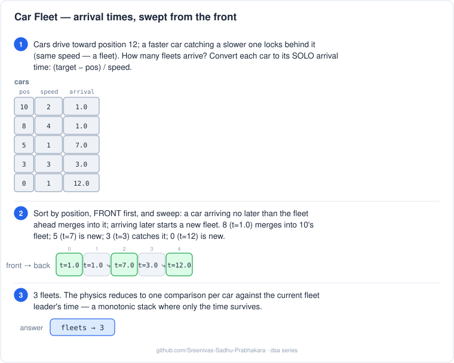

# Car Fleet

> NeetCode 150 · Stack — sort cars nearest-target-first and compare solo arrival times: slower than everything ahead means a new fleet. Go, stdlib only, tested.

## Problem

Cars at given positions drive at given speeds toward one target and cannot overtake; catching up means merging into a fleet at the slower speed. How many fleets reach the target?

## Approach

The physics collapses into one scalar per car: its *solo* arrival time `(target − pos) / speed`. Walk the cars from nearest-to-target backwards: a car with a solo time **greater** than the fleet ahead's time never catches it — it founds a new fleet whose time is its own; a car with a smaller-or-equal time crashes into the pack ahead and its speed stops mattering. So the fleet count is the count of running maxima of arrival time in position order — usually phrased with a stack, but only the top survives each comparison, so a single `leadTime` float suffices. Floating division avoids the rational-comparison fuss.

**Complexity:** O(n log n) for the sort, O(1) beyond the index slice.

## Visual walkthrough

Read the picture top to bottom — each numbered frame is one moment of the algorithm
running on this repo's test example.

## Run

    go test ./...   # verify
    go run .        # demo

---

Part of a 275-repo DSA series in Go — Striver's SDE Sheet (dsa-001–191) plus the NeetCode 150 / Blind 75 additions (dsa-192–275), stdlib only, every solution tested. Browse: [`dsa-*` repos](https://github.com/Sreenivas-Sadhu-Prabhakara?tab=repositories&q=dsa-&type=source).
